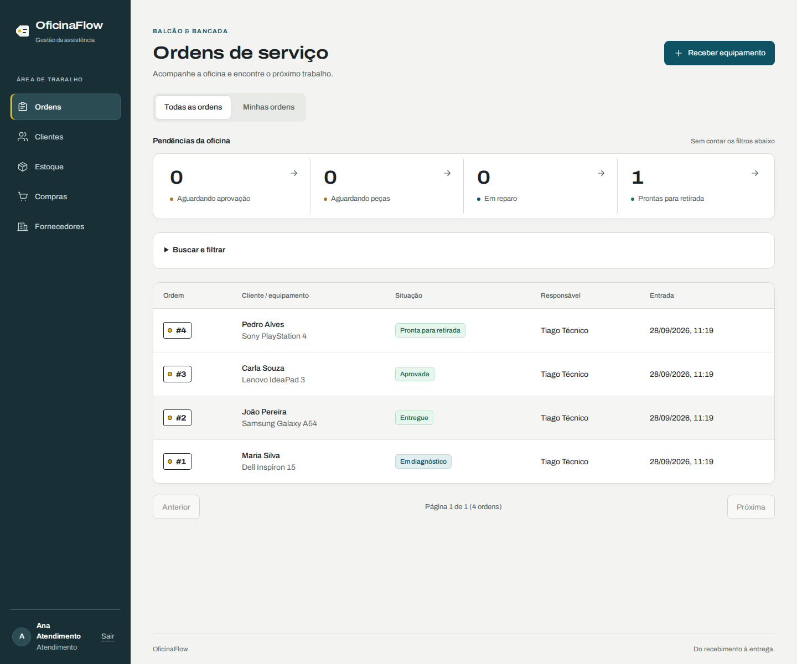
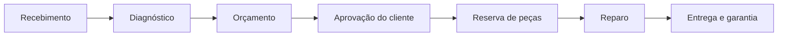

# OficinaFlow

**Gestão de ordens de serviço para assistências técnicas, do recebimento à entrega.**

[](https://github.com/joaopedroplinta/oficinaflow/actions/workflows/ci.yml)

O OficinaFlow conecta atendimento, diagnóstico, orçamento e estoque em uma mesma
ordem. Preserva o histórico do equipamento e a rastreabilidade das peças, com
regras para manter aprovações e saldos coerentes quando um orçamento muda ou
duas pessoas trabalham ao mesmo tempo.

[Demonstração](https://oficinaflow-production.up.railway.app) ·
[Instalação](#executar-localmente) ·
[Arquitetura](#arquitetura) ·
[Testes](#qualidade-e-testes) ·
[Documentação](#documentação)



_Interface em ambiente local, com dados de demonstração._

## Funcionalidades

| Área                 | Recursos                                                                                                    |
| -------------------- | ----------------------------------------------------------------------------------------------------------- |
| Atendimento          | Clientes e equipamentos, recebimento guiado, relato, condição de entrada, acessórios, filtros e pendências. |
| Diagnóstico e reparo | Responsável técnico, diagnóstico, trabalho executado, conclusão e entrega.                                  |
| Orçamentos           | Peças e serviços, versões, decisão do cliente com nome/canal/data e adendos durante o reparo.               |
| Estoque              | Entradas, reservas, consumo, estornos e histórico; reserva e início parciais opcionais.                     |
| Compras              | Fornecedores, pedidos com recebimento parcial e custo médio ponderado das peças.                            |
| Documentos           | PDFs de ordens e orçamentos, anexos privados, envio por e-mail e link de WhatsApp.                          |
| Pós-serviço          | Garantia e novas ordens de garantia ou retrabalho vinculadas à entrega original.                            |
| Interface            | Português, horário de Brasília, layout responsivo, teclado e proteção de alterações não salvas.             |

## Fluxo de trabalho



A decisão do cliente é registrada pelo atendimento. Revisões preservam as
decisões anteriores e exigem nova aprovação; serviços adicionais durante o
reparo entram por adendo. Cancelamento e devolução são etapas distintas,
mantendo registrado quando o equipamento ainda está na assistência.

## Arquitetura

Monólito modular: o Laravel serve a aplicação React e a API REST em `/api/v1`.
A autenticação usa sessão e cookies com Laravel Sanctum. Não há dependência
de Inertia, Redis ou workers de fila no fluxo atual.

| Camada         | Tecnologia                                  |
| -------------- | ------------------------------------------- |
| Backend        | Laravel 13, PHP 8.4+; CI em PHP 8.5         |
| Banco de dados | PostgreSQL 18                               |
| Frontend       | React 19, TypeScript, Tailwind CSS 4 e Vite |
| Autenticação   | Laravel Sanctum em modo SPA                 |
| Documentos     | Laravel Dompdf e Laravel Mail               |
| Qualidade      | PHPUnit, Laravel Pint e Playwright          |

```text
app/Actions/               Casos de uso, transações e locks
app/Policies/              Autorização por operação
app/Http/Requests/         Validação de entrada
app/Http/Controllers/      Coordenação das requisições
app/Http/Resources/        Contratos de resposta da API
resources/js/             Páginas, componentes e cliente HTTP da SPA
resources/css/            Tokens e estilos da interface
tests/Feature/Concurrency/ Cenários com conexões reais ao PostgreSQL
tests/Browser/            Jornadas em desktop e celular
```

### Consistência dos dados

- **Aprovação vinculada à versão:** uma decisão não é transferida para um
  orçamento revisado. Versões emitidas e decisões têm proteção de imutabilidade.
- **Histórico preservado:** identificação do equipamento, descrição e preço
  dos itens são copiados para os registros da operação.
- **Estoque transacional:** locks, validação e constraints protegem saldos e
  reservas. O padrão reserva tudo ou nada; operações parciais são explícitas.
- **Consumo idempotente:** repetir o início do reparo não baixa as mesmas peças
  novamente. Reservas concluídas também não são duplicadas.
- **Movimentações rastreáveis:** entradas, consumos e estornos ficam em um
  livro-razão que não permite alteração ou exclusão.
- **Auditoria:** mudanças de estado registram autor, horário e contexto na
  linha do tempo da ordem.

Dinheiro usa centavos inteiros, quantidades são inteiras e datas incluem fuso.
Consulte o [modelo de dados e as transições](docs/architecture.md).

## Executar localmente

### Pré-requisitos

- PHP 8.4+, com as extensões exigidas pelo Composer e `pdo_pgsql`.
- Composer 2, Node.js 24 e npm.
- Docker com Docker Compose.
- Shell compatível com `sh`, disponível em Linux, macOS ou WSL.

O Docker inicia apenas o PostgreSQL; PHP e Node.js são executados localmente.

### Instalação inicial

```bash
git clone https://github.com/joaopedroplinta/oficinaflow.git
cd oficinaflow

composer install
npm ci
cp .env.example .env
php artisan key:generate
npm run build

DB_PORT=5433 docker compose up -d --wait pgsql
DB_PORT=5433 php artisan migrate --seed
npm run start:local
```

Acesse **<http://localhost:8016>**.

O comando `start:local` usa o PostgreSQL na porta **5433** e o servidor na
**8016**, configurando `localhost:8016` e `127.0.0.1:8016` como origens aceitas
pelo login. Os ajustes valem para o processo, sem modificar o `.env`.

O seed inicial cria usuários e quatro ordens de demonstração. Rode
`migrate --seed` uma vez em um banco novo; nas atualizações seguintes, use
apenas `migrate`.

### Contas de demonstração

| Perfil      | E-mail                     | Senha local |
| ----------- | -------------------------- | ----------- |
| Atendimento | `admin@oficinaflow.test`   | `password`  |
| Técnico     | `tecnico@oficinaflow.test` | `password`  |

Essas senhas são exclusivas de desenvolvimento e testes. Fora desses ambientes,
o seed exige `DEMO_PASSWORD` com pelo menos 12 caracteres. Não há cadastro público.

### Desenvolvimento

Mantenha `npm run start:local` aberto e execute `npm run dev` em outro terminal
para atualização dos assets com Vite.

| Comando                            | Finalidade                                                   |
| ---------------------------------- | ------------------------------------------------------------ |
| `npm run start:local`              | Iniciar banco e aplicação com as portas locais configuradas. |
| `npm run dev`                      | Iniciar o Vite com atualização da interface.                 |
| `npm run build`                    | Verificar tipos e gerar assets de produção.                  |
| `DB_PORT=5433 php artisan migrate` | Aplicar migrations no banco local.                           |
| `npm run format`                   | Formatar a interface e os testes de navegador.               |

Comandos Artisan separados precisam de `DB_PORT=5433` para acessar o mesmo
banco. Outras portas podem ser escolhidas ao iniciar o servidor:

```bash
OFICINAFLOW_DB_PORT=5434 OFICINAFLOW_PORT=8020 npm run start:local
```

Se usar outra porta de banco, aplique o mesmo valor nos comandos Artisan e testes.

## Qualidade e testes

```bash
./vendor/bin/pint --test
npm run build
DB_PORT=5433 php artisan test
```

A suíte PHP usa `oficinaflow_testing`. Os testes de concorrência abrem conexões
reais ao PostgreSQL para exercitar disputas de estoque, revisões de orçamento e
transições simultâneas:

```bash
DB_PORT=5433 php artisan test tests/Feature/Concurrency
```

### Testes de navegador

```bash
DB_PORT=5433 php artisan test
APP_ENV=testing DB_PORT=5433 DB_DATABASE=oficinaflow_testing php artisan db:seed --class=BrowserTestSeeder --force
npm run build
npx playwright install chromium
DB_PORT=5433 npm run test:browser
```

O Playwright inicia um servidor na porta **8012** e cobre a página inicial,
recebimento até entrega, proteção de rascunhos, filtros, validação e acesso por
perfil, em desktop e celular. Capturas e traces de falhas ficam em `test-results/`.

Execute PHP e Playwright em sequência: ambos usam o banco de testes, cujas
tabelas são recriadas pela suíte PHP. O `BrowserTestSeeder` aceita somente esse
banco em ambiente de testes. Pare o Vite antes de validar o build ou rodar
Playwright: `public/hot` direciona o Laravel para os assets de desenvolvimento.

O [CI](.github/workflows/ci.yml) executa Pint, tipos, testes PHP contra PostgreSQL
e testes de navegador em pull requests e pushes na `main`.

## Perfis de acesso

| Operação                                            | Atendimento | Técnico |
| --------------------------------------------------- | :---------: | :-----: |
| Consultar ordens, clientes, peças e histórico       |     Sim     |   Sim   |
| Registrar diagnóstico; iniciar e concluir reparo    |     Sim     |   Sim   |
| Abrir ordens e manter clientes e equipamentos       |     Sim     |    —    |
| Elaborar orçamentos e registrar decisões do cliente |     Sim     |    —    |
| Gerenciar estoque, fornecedores e compras           |     Sim     |    —    |
| Cancelar, entregar e registrar devolução            |     Sim     |    —    |

A autorização é aplicada no servidor por Policies e verificada pela matriz de
permissões da API. Usuários inativos não autenticam e perdem acesso à sessão.
O responsável atribuído organiza o trabalho; qualquer técnico ativo pode iniciar
e concluir uma ordem.

## Escopo e operação

O sistema atende uma assistência, com um estoque e um equipamento por ordem.
Não inclui multiempresa, pagamentos, notas fiscais, portal de aprovação do
cliente, assinatura digital ou permissões configuráveis.

O e-mail depende de SMTP; no modo `MAIL_MAILER=log`, o conteúdo é registrado
localmente. O WhatsApp fornece um link para envio manual. Fotos e documentos
são privados e seu download exige autorização.

O ambiente de demonstração usa hospedagem na Railway. Configuração,
persistência, proxies, e-mails e publicação estão descritos em
[Operação em produção](docs/operations.md).

## Documentação

| Documento                           | Conteúdo                                          |
| ----------------------------------- | ------------------------------------------------- |
| [Arquitetura](docs/architecture.md) | Modelo, estados e contratos de consistência.      |
| [Operação](docs/operations.md)      | Variáveis de ambiente e publicação.               |
| [Demonstração](docs/demo.md)        | Roteiro com as ordens do seed.                    |
| [Plano do projeto](PLANO.md)        | Escopo, decisões e desenho dos casos de uso.      |
| [Convenções](CLAUDE.md)             | Organização do código e fluxo de desenvolvimento. |
| [Changelog](CHANGELOG.md)           | Histórico das versões.                            |
