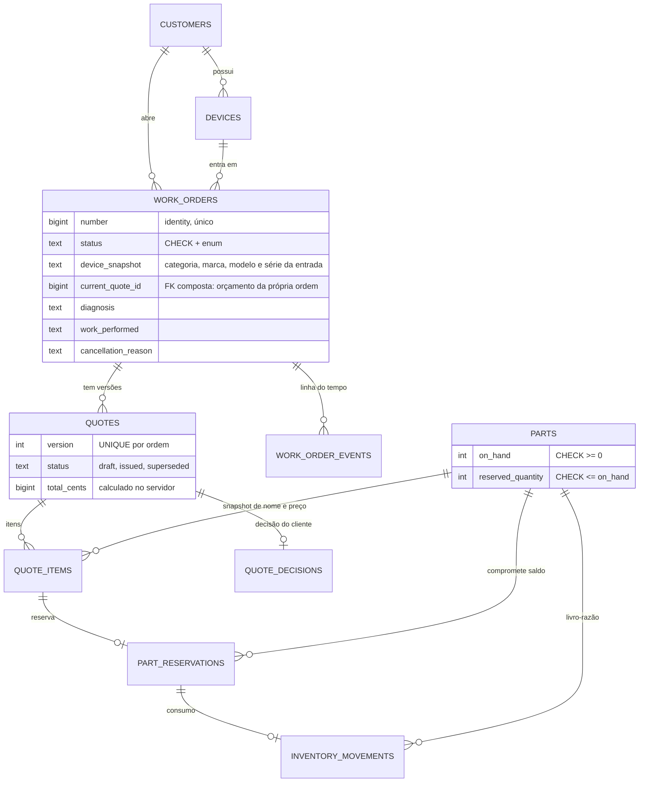
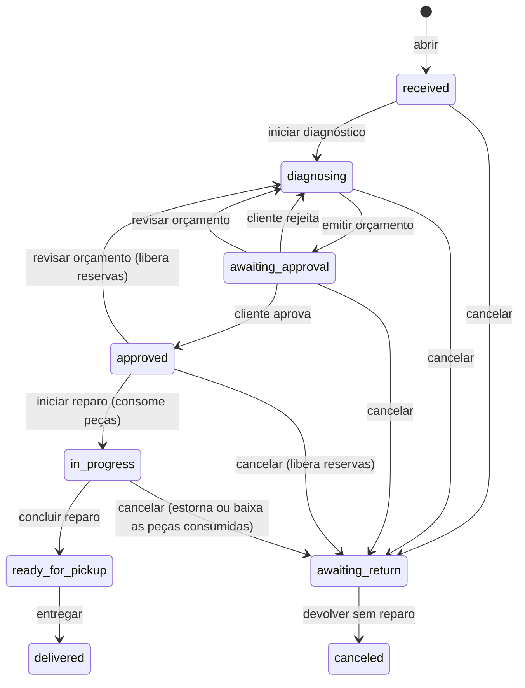

# OficinaFlow

Sistema de ordens de serviço para assistência técnica. O percurso do MVP:

**receber equipamento → diagnosticar → orçar → registrar a aprovação do cliente → reservar peças → reparar → entregar**

O ponto técnico do projeto é manter **aprovação, estoque e execução coerentes** mesmo quando o orçamento muda ou duas pessoas agem ao mesmo tempo. Cada regra abaixo é imposta pela aplicação **e** pelo banco, e provada por teste em PostgreSQL.

> Projeto de portfólio. Escopo, modelo e cronograma completos em [`PLANO.md`](PLANO.md); convenções e comandos de desenvolvimento em [`CLAUDE.md`](CLAUDE.md).

## O problema

Numa assistência técnica, o orçamento muda (o cliente pede mais um serviço, a peça sobe de preço), o estoque é disputado por várias ordens e o técnico e o atendimento mexem na mesma ordem. Quando isso é feito em planilha ou em telas sem regra, aparecem os erros clássicos: aprovação valendo para um orçamento que já foi trocado, a mesma peça prometida a dois clientes, saldo negativo, peça baixada duas vezes.

## Escopo

**Entra:** login com dois perfis (atendimento e técnico); clientes, equipamentos e catálogo de peças; abertura de ordem com relato, condição de entrada e acessórios; diagnóstico e responsável técnico; orçamento com peças e serviços, **versões** e aprovação registrada pelo atendimento (nome, canal e data); reserva integral de peças, consumo ao iniciar o reparo e liberação na revisão ou no cancelamento; entrada simples de estoque com histórico; conclusão, entrega, cancelamento antes do reparo e devolução sem reparo; linha do tempo de cada ordem; filtros por estado, cliente e número; interface responsiva em português.

**Fica fora** (decisão de escopo): multiempresa, portal do cliente e assinatura digital, WhatsApp automático por API, pagamentos e notas fiscais, permissões configuráveis. Lista completa em `PLANO.md` §8.

**Fase 2 (em andamento, `PLANO.md` §13):** PDF, anexos/fotos e envio do orçamento por e-mail; garantia, retrabalho e reabertura (nova ordem vinculada); reserva/consumo parcial, adendo ao orçamento e devolução de peças durante o reparo; compras e custo médio. As regras do MVP abaixo valem até cada item ser entregue.

## Stack

Laravel 13 (PHP 8.5) · PostgreSQL 18 · React + TypeScript + Tailwind 4 (Vite) · Sanctum em modo SPA (sessão) · PHPUnit. Monólito modular: o Laravel serve o shell React e a API REST em `/api/v1`. Sem Inertia, sem filas, sem Redis.

## Como rodar

```bash
docker compose up -d --wait            # PostgreSQL (bancos oficinaflow e oficinaflow_testing)
cp .env.example .env && php artisan key:generate
composer install && npm ci && npm run build
php artisan migrate --seed             # usuários e as 4 ordens de demonstração
php artisan serve                      # http://localhost:8000
```

Usuários de demonstração (senha `password`, **só em ambiente local**):

| E-mail | Perfil |
|---|---|
| `admin@oficinaflow.test` | Atendimento (administrador) |
| `tecnico@oficinaflow.test` | Técnico |

Desenvolvimento: `npm run dev` (Vite com HMR). Qualidade: `./vendor/bin/pint`, `npm run build` (roda `tsc`) e `php artisan test`.

### Testes

```bash
php artisan test                       # sempre em PostgreSQL (oficinaflow_testing)
php artisan test tests/Feature/Concurrency
```

Os testes de concorrência (`tests/Feature/Concurrency/`) usam **duas conexões reais**: uma segura a transação de uma Action em andamento, um processo separado dispara a segunda e fica bloqueado no `lockForUpdate`, e só então a primeira confirma. Depois de cada cenário conferem os invariantes de estoque. Foram validados por mutação (tirar um `lockForUpdate` ou a idempotência faz um teste falhar). O CI (`.github/workflows/ci.yml`) roda Pint, `tsc` e a suíte contra PostgreSQL a cada push; também executa fluxos no Chromium em desktop e celular, guardando capturas e traces em caso de falha.

### Interface e testes de navegador

A área de ordens reúne pendências clicáveis, “Minhas ordens”, filtros por técnico,
período de entrada (horário de Brasília), cliente, estado e ordenação. O recebimento
é guiado em três etapas, com cadastro de cliente e equipamento no próprio fluxo.
O detalhe destaca a próxima ação e mantém formulários montados em seções
recolhíveis. Diagnóstico, orçamento e dados de entrada avisam antes de sair sem salvar.

Para testar localmente, rode a suíte PHP primeiro e prepare **somente o banco de testes**:

```bash
php artisan test
APP_ENV=testing DB_DATABASE=oficinaflow_testing php artisan db:seed --class=BrowserTestSeeder --force
npm run build
npx playwright install chromium
npm run test:browser
```

O Playwright inicia e encerra um servidor na porta 8012, usando
`oficinaflow_testing`. Não rode a suíte PHP em paralelo: ela recria as tabelas de
teste. O seeder cria apenas usuários fictícios e recusa outros ambientes/bancos.
Cada execução de navegador cadastra seus próprios clientes e ordens, preservados
até a próxima execução da suíte PHP. Falhas geram capturas e traces em `test-results/`.

### Variáveis de ambiente em produção

| Variável | Para quê |
|---|---|
| `APP_ENV=production`, `APP_DEBUG=false`, `APP_KEY` | Ambiente e chave da aplicação |
| `APP_URL` | URL pública |
| `DB_CONNECTION=pgsql`, `DB_HOST`, `DB_PORT`, `DB_DATABASE`, `DB_USERNAME`, `DB_PASSWORD` | PostgreSQL |
| `SANCTUM_STATEFUL_DOMAINS` | Domínio do SPA (sem isso o login não abre sessão e responde 403 "Origem não autorizada") |
| `SESSION_SECURE_COOKIE=true`, `SESSION_DOMAIN` | Cookie de sessão seguro |
| `TRUSTED_PROXIES` | IPs/CIDRs do proxy ou balanceador, separados por vírgula. **Vazio = não confia em nenhum** (o `X-Forwarded-For` é ignorado). Vale no `.env` e com `config:cache` |
| `APP_LOCALE=pt_BR`, `APP_FALLBACK_LOCALE=pt_BR` | Mensagens em português (já é o padrão) |
| `DEMO_PASSWORD` | **Obrigatória para semear fora de local/teste** (mínimo de 12 caracteres); sem ela o seed recusa rodar |
| `ATTACHMENTS_DISK` | Disco do Laravel onde ficam as fotos e PDFs das ordens (padrão `local`, privado em `storage/app/private`). Nunca aponte para um disco público: o download passa por rota autorizada. Em produção, use volume persistente ou S3 |
| `WARRANTY_DAYS` | Prazo da garantia em dias, contado da entrega e gravado na ordem no momento da entrega (padrão 90). Mudar o valor não altera ordens já entregues |
| `MAIL_MAILER`, `MAIL_HOST`, `MAIL_PORT`, `MAIL_USERNAME`, `MAIL_PASSWORD`, `MAIL_SCHEME`, `MAIL_FROM_ADDRESS`, `MAIL_FROM_NAME` | Envio do orçamento por e-mail (PDF em anexo). Padrão `MAIL_MAILER=log`: o e-mail vai para `storage/logs/laravel.log`, nada sai. Em produção use `smtp` com as credenciais do provedor (`MAIL_SCHEME=smtps` para a porta 465, vazio para STARTTLS na 587) e um `MAIL_FROM_ADDRESS` do seu domínio. O envio é síncrono: se o SMTP falhar, o atendimento vê o erro e nada consta como enviado. O WhatsApp é só um link `wa.me` que o atendente abre e envia; o sistema nunca envia por conta própria |

Atrás de proxy/balanceador, defina `TRUSTED_PROXIES` só com o proxy real (nunca `*` sem saber que ele sobrescreve o cabeçalho): o limite de tentativas do login usa o IP do cliente, e sem isso todos aparecem com o IP do proxy.

### Deploy na Railway

Publicado em <https://oficinaflow-production.up.railway.app> (projeto `oficinaflow`: serviço `oficinaflow` + Postgres). O Railpack detecta o Laravel, roda `npm run build`, `migrate --force` a cada start e serve com FrankenPHP; ele escolhe o PHP pelo `composer.json` (por isso `^8.4`, o piso das dependências).

```bash
railway up --service oficinaflow                                  # deploy do diretório atual
railway ssh --service oficinaflow -- php artisan db:seed --force  # UMA vez: usuários e ordens de demo
```

- No serviço `oficinaflow`, `DB_*` referenciam o Postgres (`${{Postgres.PGHOST}}` etc.), `LOG_CHANNEL=stderr` e um volume em `/app/storage/app/private` guarda os anexos.
- O seed **não é idempotente** (e-mails únicos): rodar de novo falha. O Railpack não semeia no start; só migra.
- `railway ssh` pede uma chave registrada (`railway ssh keys add`) e a confirmação do host na primeira conexão, em terminal interativo.

## Modelo de dados



Dinheiro sempre em **centavos inteiros**; quantidades inteiras; datas em `timestamptz`; estado é coluna texto com `CHECK` e enum PHP com rótulo em português.

## Máquina de estados da ordem



Não existe edição livre de `status`: cada transição é uma rota-verbo com pré-condições próprias. `awaiting_return` significa serviço cancelado com o equipamento **ainda na assistência**: cancelar não é devolver nem entregar. "Aprovada mas aguardando peças" é um **indicador** na tela, não um estado.

## Regras que o sistema garante

- **Aprovação presa à versão.** Uma decisão do cliente refere-se a uma versão específica do orçamento. Revisar cria outra versão em rascunho, substitui a atual, libera as reservas e devolve a ordem ao diagnóstico; a aprovação antiga fica no histórico (imutável) e **não** vale para a nova.
- **Versão emitida é imutável** — na Action e no banco (triggers recusam alterar itens, total ou observações fora do rascunho). No máximo uma versão não substituída por ordem (índice único parcial).
- **Reserva tudo ou nada.** Falta uma peça → nenhuma reserva e `409 INSUFFICIENT_STOCK` com o detalhe do que falta. Repetir o pedido devolve as reservas existentes.
- **Consumo atômico e idempotente.** Iniciar o reparo baixa `on_hand` e `reserved_quantity` juntos, marca as reservas como consumidas e grava o consumo no livro-razão numa única transação; qualquer falha desfaz tudo; repetir não consome de novo.
- **Estoque explicável.** `on_hand` = entradas − consumos; `reserved_quantity` = soma das reservas ativas; nunca negativo (`CHECK`). O livro-razão é append-only.
- **Snapshots.** Nome e preço de cada item do orçamento e a identificação do equipamento na entrada são copiados: alterar o catálogo ou o cadastro depois não muda o histórico.
- **Locks em ordem fixa.** Toda Action que muda estado trava a **ordem primeiro** e só depois valida; as peças são travadas em **ordem crescente de ID**, o que evita deadlock.
- **Tela desatualizada.** Ações que dependem de orçamento enviam o `quote_id` que a tela mostrava; comparado com a versão atual depois do lock → `409 QUOTE_SUPERSEDED`.
- **Auditoria.** Toda transição relevante grava um evento com autor, tipo, estado de/para e metadados (decisão: nome, canal e data).

Erros de API: `422` validação, `403` permissão, `409` conflito com `code` estável (`QUOTE_SUPERSEDED`, `INSUFFICIENT_STOCK`, `INVALID_TRANSITION`), `429` excesso de tentativas de login.

## Permissões

| Ação | Atendimento | Técnico |
|---|:---:|:---:|
| Consultar ordens, clientes, peças e linha do tempo | ✅ | ✅ |
| Iniciar diagnóstico, registrar diagnóstico, iniciar e concluir reparo | ✅ | ✅ |
| Abrir ordem; cadastrar clientes e equipamentos | ✅ | — |
| Orçamento (criar, editar, emitir, revisar) e decisão do cliente | ✅ | — |
| Peças, entradas de estoque, movimentos e reservas | ✅ | — |
| Cancelar serviço, entregar e devolver sem reparo | ✅ | — |

Toda ação passa por uma **Policy**. `PermissionMatrixTest` cobre as 33 rotas protegidas da API (a única pública é o login) para visitante, usuário inativo, técnico e atendimento, e falha se surgir uma rota sem entrada na matriz. Usuário inativo não autentica e perde a sessão aberta.

## Arquitetura em uma olhada

```
app/Actions/<Domínio>/   uma classe por caso de uso, dona da transação e dos locks
app/Policies/            autorização por ação
app/Http/Requests/       validação (Form Request) e autorização de entrada
app/Http/Controllers/    finos: validam, autorizam, chamam a Action
app/Http/Resources/      formato do JSON (nunca o Model cru)
resources/js/            SPA React: pages, components, api.ts (único ponto de fetch)
tests/Feature/Concurrency/  duas conexões reais ao PostgreSQL
```

## Roteiro da demonstração

O `php artisan migrate --seed` cria quatro ordens de exemplo: **em diagnóstico**, **aprovada sem estoque** (aguardando peças), **orçamento revisado** (V1 aprovada e substituída, V2 aguardando aprovação) e **reparo pronto**. Roteiro de poucos minutos (uma ordem completa e uma exceção):

1. Entre como **atendimento** e abra a ordem da **Carla Souza** (orçamento revisado): mostre as duas versões, a aprovação da V1 preservada no histórico e a linha do tempo. Explique: a aprovação antiga **não** vale para a V2.
2. Registre a aprovação da V2 (nome, canal e data). A ordem passa a *Aprovada*.
3. **Exceção:** abra a ordem do **João Pereira**. Ela está aprovada, mas o aviso *aguardando peças* mostra que a tela ainda não chegou. Clique em **Reservar peças**: o erro lista o que falta e **nada** é reservado.
4. Vá a **Estoque** → *Tela Galaxy A54* → **Registrar entrada** (1 unidade). Volte à ordem e reserve de novo: agora passa.
5. Entre como **técnico** e **inicie o reparo** (as peças reservadas são baixadas do estoque), **conclua** informando o trabalho executado.
6. Volte ao **atendimento**, **entregue** o equipamento e mostre a linha do tempo completa e as movimentações da peça (consumo ligado à reserva).
7. **Como o banco protege a consistência:** rode `php artisan test tests/Feature/Concurrency` e explique o cenário das duas conexões disputando a última peça (só uma vence, sem saldo negativo nem reserva parcial).

## Limitações conhecidas

- **Deploy de demonstração único** na Railway, sem domínio próprio, sem SMTP (`MAIL_MAILER=log`) e sem `TRUSTED_PROXIES`: o limite de login enxerga o IP do proxy.
- **Uma assistência, um estoque, um equipamento por ordem.** Sem multiempresa e sem peça fracionada. Reserva parcial e início parcial do reparo são opt-in (fase 2).
- **Depois de iniciado o reparo** o orçamento fica congelado: itens novos entram por **adendo** (com nova decisão do cliente); cancelar em reparo pede o destino de cada peça consumida (volta ao estoque por estorno no livro-razão ou fica baixada); só se reserva e consome o que faltou de um início parcial. Garantia e retrabalho abrem uma **nova ordem** vinculada a uma ordem entregue.
- **Escopo do técnico:** qualquer técnico ativo pode iniciar e concluir qualquer ordem (não só a atribuída a ele), e o técnico enxerga saldos de estoque, preços e as decisões de orçamento. Decisão de produto tomada: fica assim (ver PLANO.md §8).
- **Login:** limite de 5 tentativas por e-mail + IP por minuto (contadas antes da conferência da senha); não cobre força bruta distribuída (vários IPs contra o mesmo e-mail) e depende de `TRUSTED_PROXIES` correto atrás de proxy.
- **Numeração de ordens** com lacunas possíveis (sequência do PostgreSQL não volta em transação abortada).
- **Aprovação do cliente** é registrada pelo atendimento (sem portal nem assinatura digital).
- **Interface:** testes de navegador cobrem recebimento até entrega, proteção de alterações, filtros, permissões e validação acessível em desktop e celular. A revisão manual com leitor de tela ainda complementa essa cobertura.
- Seletor de peças busca código/nome no servidor, com até 20 resultados por busca; refine o termo para localizar a peça.
