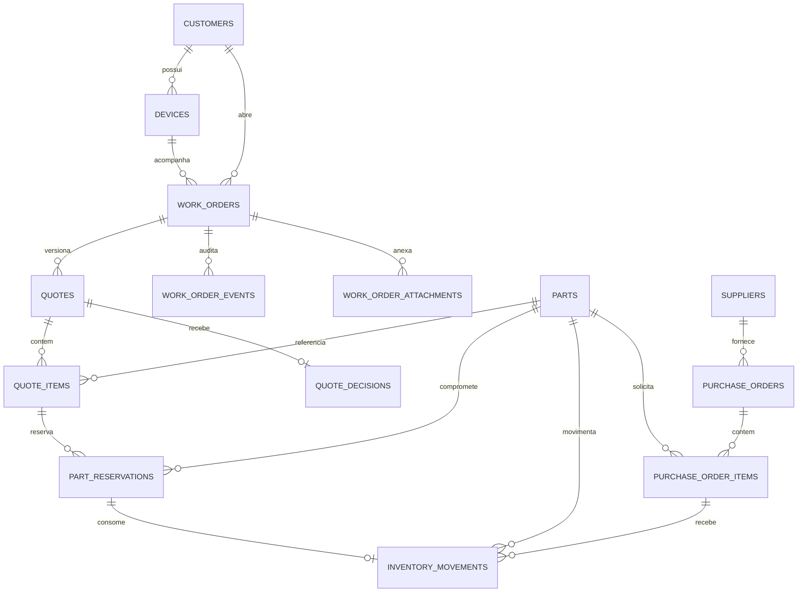
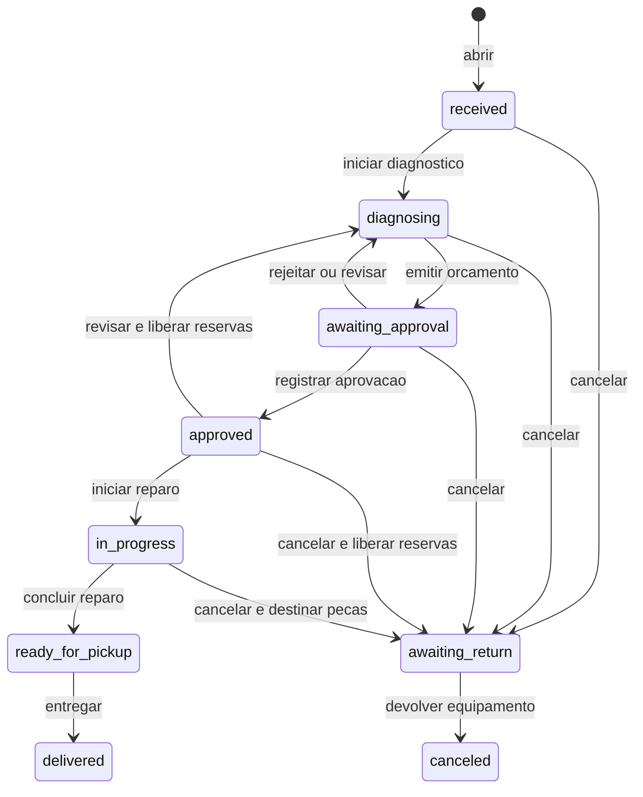

# Arquitetura e consistência

[Voltar ao README](../README.md)

## Modelo de dados

O diagrama destaca as relações centrais. Campos e constraints completos estão
nas migrations e no [PLANO.md](../PLANO.md).



Garantia e retrabalho apontam para a ordem entregue de origem. Orçamentos também
representam adendos, com numeração própria e vínculo com a versão aprovada.

Dinheiro usa centavos inteiros; quantidades são inteiras e datas são `timestamptz`.
Estados usam coluna de texto, constraint `CHECK` e enum PHP com rótulo em português.

## Estados da ordem



Não existe edição livre de `status`: cada operação tem pré-condições próprias.
`awaiting_return` identifica um serviço cancelado cujo equipamento ainda está na
assistência. “Aguardando peças” é um indicador, não um estado adicional.

## Contratos de consistência

### Orçamento e aprovação

Uma decisão refere-se a uma versão específica. Revisar substitui a versão
anterior, cria um rascunho, libera reservas e devolve a ordem ao diagnóstico.
A aprovação anterior permanece no histórico.

Versões emitidas não permitem alterações nos itens, total ou observações.
Constraints e triggers reforçam essa proteção. Durante o reparo, itens
adicionais entram por adendo e exigem nova decisão do cliente.

### Reserva e consumo

A reserva padrão é integral: se faltar uma peça, nenhuma reserva nova é gravada.
O modo parcial reserva o disponível e mantém o restante pendente. Repetir a
operação depois de reservar tudo devolve as reservas existentes.

Iniciar o reparo consome reservas, baixa saldo e quantidade reservada e grava
movimentos na mesma transação. Repetir o início não consome novamente. O início
parcial exige confirmação; peças restantes podem ser reservadas e consumidas
durante a execução.

### Estoque e estornos

O livro-razão não admite `UPDATE` ou `DELETE`. Entradas, consumos e estornos são
registros separados, e o estorno aponta para o consumo original.

```text
saldo em estoque = entradas + estornos - consumos
quantidade reservada = soma das reservas ativas
disponibilidade = saldo em estoque - quantidade reservada
```

Constraints impedem saldo negativo e reserva acima do saldo. Cancelar em reparo
exige registrar o destino das peças consumidas: estornar ou manter a baixa.

### Concorrência e histórico

Operações transacionais travam a ordem antes de validar seu estado. Quando
precisam de peças, adquirem locks em ordem crescente de ID. Ações dependentes
de orçamento enviam o `quote_id` exibido, comparado à versão atual após o lock.

Snapshots preservam identificação do equipamento, descrição e preço dos itens.
Alterar cadastros depois não reescreve a operação. Eventos registram autor,
horário, estados e contexto.

## Respostas da API

| Status | Situação                                                                             |
| ------ | ------------------------------------------------------------------------------------ |
| `401`  | Sessão ausente ou expirada.                                                          |
| `403`  | Ação não autorizada ou origem de login não configurada.                              |
| `409`  | Conflito de domínio: versão substituída, estoque insuficiente ou transição inválida. |
| `422`  | Falha de validação de entrada.                                                       |
| `429`  | Limite de tentativas de login atingido.                                              |

Conflitos usam códigos estáveis, como `QUOTE_SUPERSEDED`, `INSUFFICIENT_STOCK`
e `INVALID_TRANSITION`. A interface apresenta estados e erros em português;
a API continua sendo a fonte de verdade.

## Cobertura

Testes de feature verificam regras, validação e autorização. A matriz de
permissões compara os cenários com as rotas reais da API. Os testes de
concorrência usam duas conexões ao PostgreSQL, incluindo um processo separado
para exercitar bloqueios e validar invariantes após a disputa.

A sequência do PostgreSQL pode deixar lacunas na numeração de ordens quando
uma transação é abortada; os números continuam únicos.
